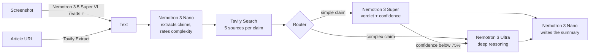

# Claim Check

**Fact-check any message, screenshot or article in about 20 seconds.** Claim Check pulls out every factual claim, searches the live web for evidence, and has NVIDIA Nemotron models running on Nebius Token Factory decide whether each one is supported, false, misleading or unverified, with sources you can click.

- **Live demo:** _link added at deploy_
- **Demo video:** _link added at submission_
- **Track:** Best Apps and Agents, Nebius x NVIDIA Global AI Hackathon

## Why

Viral forwards spread faster than anyone can check them: "lemon water kills cancer", "NASA says Earth will go dark for six days", "Bill Gates will pay you to share this". Fact-checkers debunk them, but the debunk rarely reaches the family group chat. Claim Check lets anyone paste the message (or drop a screenshot of it) and get an itemised, sourced answer they can send back.

## How it works



1. **Read.** Text is used as-is. A screenshot is read by Nemotron 3.5 Super VL; an article URL is fetched with Tavily Extract.
2. **Extract.** Nemotron 3 Nano lists up to six checkable claims, writes a search query for each, and rates each one `simple` or `complex`.
3. **Search.** Tavily searches the live web for each claim (social and video sites are excluded, since they mostly repeat the claim rather than evidence about it).
4. **Verify.** A router sends simple claims to Nemotron 3 Super and complex ones straight to Nemotron 3 Ultra. If Super is less than 75% confident, the claim is escalated to Ultra for a second opinion. Each verdict comes with a confidence score, a plain-language explanation, citations, and the model's reasoning.
5. **Report.** The credibility score is calculated in code from the verdicts (so it can't contradict them), and Nano writes the headline and summary.

Everything streams to the browser as it happens. The **Agent trace** panel shows every model call and web search with its model, latency and token count.

## How we use NVIDIA Nemotron

| Model on Token Factory | Job in Claim Check | Thinking |
|---|---|---|
| `nvidia/NVIDIA-Nemotron-3-Nano-30B-A3B` | Extract claims, rate complexity, write the summary | Off, for speed |
| `nvidia/nemotron-3-super-120b-a12b` | Verify simple claims | On |
| `nvidia/Nemotron-3-Ultra-550b-a55b` | Verify complex claims and escalations from Super | On |
| `nvidia/Nemotron-3.5-Super-VL` | Read screenshots | Off |

The split follows the track's advice: Ultra for serious reasoning, Nano and Super for the fast, everyday calls. In our tests a typical check makes 4 to 8 model calls and costs **about half a US cent** in Token Factory credit.

## Where Token Factory helped

- **One OpenAI-compatible endpoint for four NVIDIA models.** We use the official `openai` SDK with a custom base URL, so switching a tier to a different model is a one-line config change.
- **`GET /v1/models?verbose=true` returns pricing, context length and supported features**, which we used to pick the model for each tier and to estimate the cost of a check before writing any code.
- **Reasoning on/off per call** with `chat_template_kwargs: { enable_thinking: false }`. Turning thinking off made Nano about 3x faster on the extraction step (3.1 s to 0.9 s on our test prompt) with the same output.
- **Reasoning returned separately** in `message.reasoning`, which we show to users as "How Nemotron Ultra reasoned".
- **Images accepted as base64 data URLs** by the VL model, so screenshots need no separate upload storage.

**Other tools:** [Tavily](https://tavily.com) Search and Extract for live evidence and article reading. The app is hosted on Vercel; all model inference runs on Nebius Token Factory.

## Run it yourself

You need Node.js 20.9 or newer, a [Nebius Token Factory](https://tokenfactory.nebius.com) API key and a [Tavily](https://app.tavily.com) API key.

```bash
git clone <this repository>
cd claim-check
npm install
cp .env.example .env.local    # then fill in the keys
npm run models                # lists the NVIDIA model IDs your key can use
npm run dev                   # open http://localhost:3000
```

### Configuration

| Variable | Required | What it does |
|---|---|---|
| `NEBIUS_API_KEY` | Yes | Token Factory API key |
| `NEBIUS_API_BASE` | No | Defaults to `https://api.tokenfactory.nebius.com/v1/` |
| `NEMOTRON_NANO_MODEL` | Yes* | Claim extraction and summaries |
| `NEMOTRON_SUPER_MODEL` | Yes* | Verdicts on simple claims |
| `NEMOTRON_ULTRA_MODEL` | Yes* | Verdicts on complex claims |
| `NEMOTRON_VISION_MODEL` | No | Enables screenshot checking |
| `TAVILY_API_KEY` | Yes | Web search and article extraction |
| `CHECKS_PER_IP_PER_HOUR` | No | Per-visitor limit, default 10 |
| `CHECKS_PER_DAY` | No | Total daily limit, default 40 |

\* At least one text model is required. A missing tier falls back to another one, so the app runs with a single model.

### API

`POST /api/check` with `{ "text": "..." }`, `{ "url": "https://..." }` or `{ "image": "data:image/jpeg;base64,..." }` returns a stream of newline-delimited JSON events (`claims`, `sources`, `routing`, `verdict`, `report`, `trace`, `done`). See [src/lib/types.ts](src/lib/types.ts).

### Project layout

```
src/lib/pipeline.ts      the agent: extraction, routing, verification, report
src/lib/nebius.ts        Token Factory client, JSON validation and retry, reasoning capture
src/lib/tavily.ts        web search and article extraction
src/lib/limits.ts        rate limits that protect the demo's credits
src/app/api/check/       streaming API route
src/components/          the interface: claim cards, report card, agent trace
scripts/list-models.mjs  lists the NVIDIA models available to your key
```

## Limitations

- Verdicts are only as good as the sources the search finds; the app says "unverified" rather than guessing when they don't settle a claim.
- Rate limits are kept in memory per server instance, which stops casual abuse but isn't a hard global cap.
- English text works best.

## Feedback on Nebius Token Factory and NVIDIA models

**What worked well**
- Drop-in OpenAI compatibility: the official SDK worked unchanged, including image input.
- The verbose model list with pricing and supported features is excellent for building cost-aware routing.
- Nemotron 3 Nano with thinking off is fast (under a second for short prompts) and followed our JSON format reliably.
- Nemotron 3 Ultra's verdicts on nuanced claims were well reasoned and cited the right sources.
- Latency was consistently low for every model we used.

**What could be better**
- We couldn't find the thinking toggle (`chat_template_kwargs.enable_thinking`) or the `message.reasoning` field in the quickstart; we found both by testing. Other vLLM-based APIs return `reasoning_content`, so documenting this would save time.
- The quickstart shows a DeepSeek example but not how to list models or which Nemotron IDs exist; a "list models" snippet next to it would help.
- Nemotron 3.5 Super VL repeated its JSON answer twice in one reply and ignored instructions to leave out sender names, so we gave it structured fields instead. Nano without thinking sometimes split one claim into two despite instructions.
- The trial credit expires after 30 days, which ends before the hackathon's judging period; participants have to remember to add credits or a card to keep their demo running.

## Built during the hackathon

Claim Check was created from scratch during the submission period (October 2026).

## License

[MIT](LICENSE)
